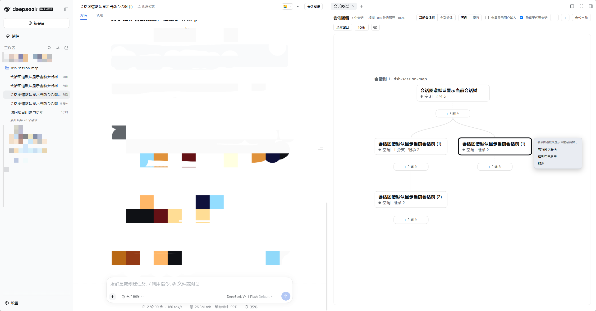
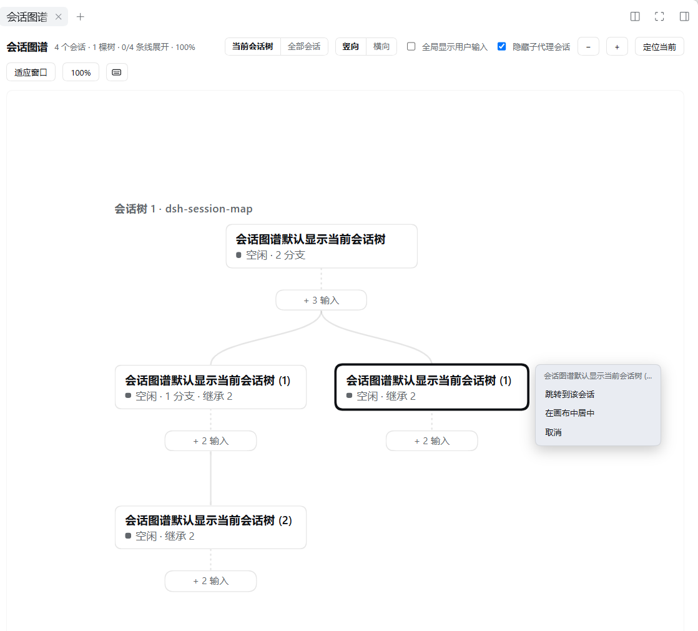
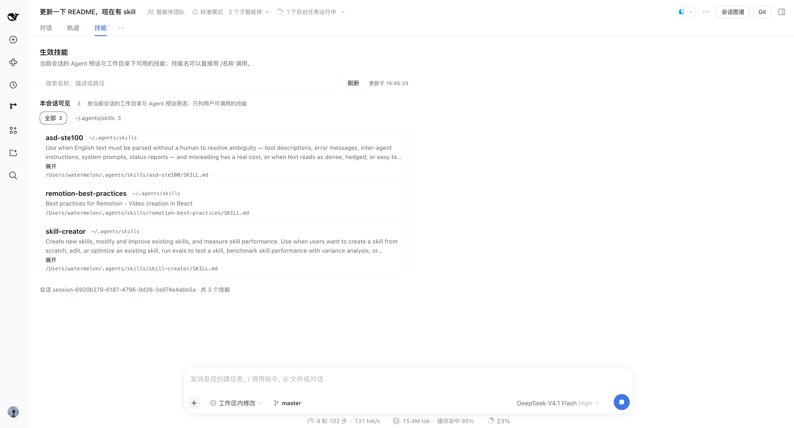
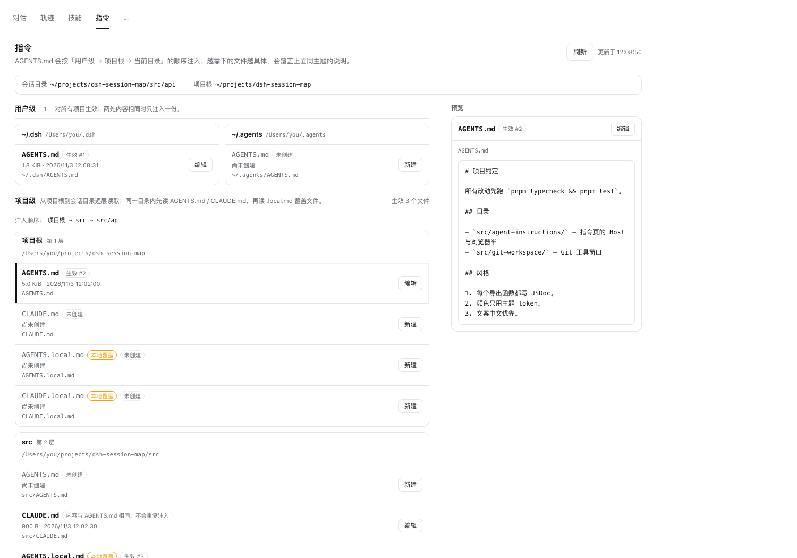
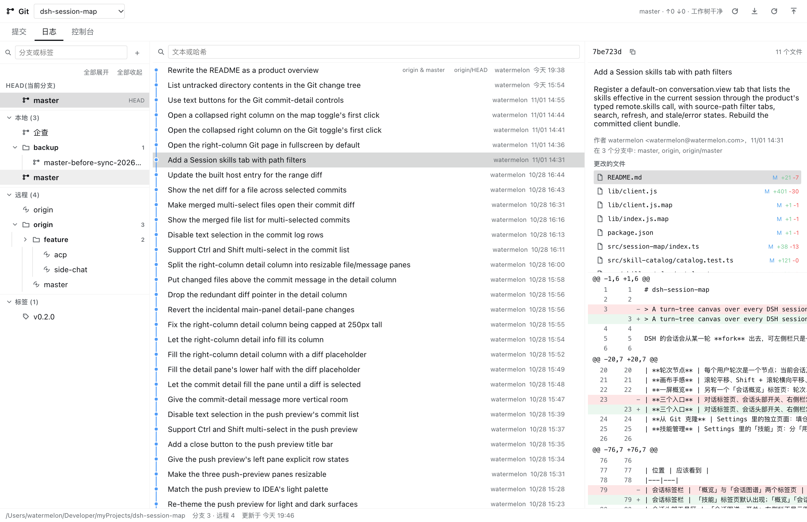
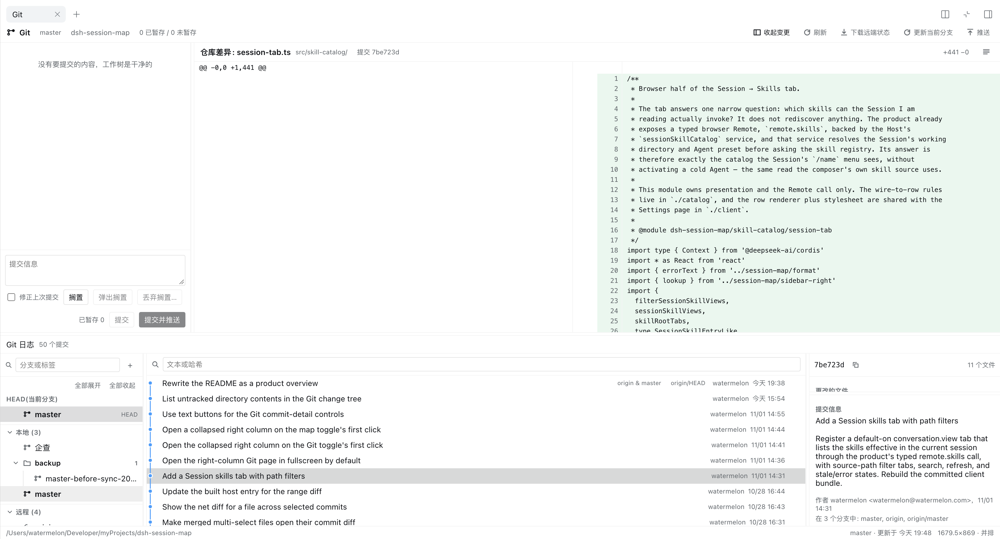

# dsh-session-map

> **会话图谱 · 技能面板 · AGENTS.md 管理器 · IDE 风格的 Git 工具窗口** —— 让 DSH 里的分叉、能力和代码状态都变得一目了然。

DSH 的会话会从某一轮 **fork** 出去，可左侧栏只是一张平铺列表：谁从谁分叉、手上这个会话在整张图里的位置，都得自己回忆。这个插件把**用户轮次**画成树——每一轮输入是一个节点，会话退成一条颜色和一枚会话标题标签——于是「从哪一句话分出去的」一眼可见；同一段被继承的历史只画一次，不再折成 `+N 继承` 胶囊。

同时，它把 DSH 日常最费手的几件事也收进了同一个插件：**当前会话能用哪些技能**、**当前会话会读到哪些 AGENTS.md、分别写在哪几层**，以及一套**IDE 风格的 Git 工具窗口**。

[](LICENSE)
[](https://github.com/xiguazhiPrince/dsh-session-map/stargazers)



## 为什么值得装

| 你平时遇到的问题 | 这个插件怎么解决 |
|---|---|
| 说不清这个会话是从哪一句话分叉出来的 | 把用户轮次画成树：会话是一条彩色线，fork 从真正被继承的那一轮长出来，继承的历史只画一次 |
| 不知道当前会话到底能用哪些 `/` 技能 | 会话内「技能」标签页直接列出实际生效、可用的技能，不用先问 Agent |
| 说不清这个项目的指令写在哪、为什么没生效 | 会话内「指令」标签页按用户级和项目每一层列出 AGENTS.md，直接编辑、新建，并标出生效顺序与去重 |
| 想看一眼分支、提交、diff，却得切到终端敲 git | 左侧栏的 Git 工具窗口 + 会话头的一键 Git 页面，提交、日志、diff 都在 DSH 里完成 |

## 功能亮点

### 会话图谱：一眼看清从哪一句话分叉

- **每个用户轮次都是一个节点**：轮次号、提示预览、分叉数都在节点上；点节点弹出菜单，可跳到对应会话或在画布中居中。
- **会话 = 颜色 + 标签**：颜色按会话稳定生成，标签挂在该会话自己的第一轮上；当前会话的整条链高亮，一眼定位「我在哪」。
- **默认只画当前会话所在的那棵树**：父链、兄弟分支和后代都在，读一个会话时不会淹没在全图里；一键切回「全部会话」。
- **默认自上而下生长**：下一轮在上一轮下方，fork 在两侧展开；也可以一键切回横向。
- **长时间线不臃肿**：共享的继承前缀只画一次；空会话显示为会话头 chip；长直链自动折叠成 `+N 条输入`，点开即可。
- **画布手感**：滚轮平移、Shift + 滚轮横移、Ctrl / ⌘ + 滚轮缩放、拖空白平移，外加适应窗口 / 定位当前 / 100%。
- **顺带还有一屏概览**：轮次、步骤、模型耗时、工具耗时、输出 token、运行状态。



### 技能：当前会话能用的，和全机都有的，分开看

- **「技能」标签页（默认出现）**：只列**当前会话实际生效**的技能——按会话的工作目录与 Agent 预设解析，且只返回可用 `/名称` 调用的那些；支持按来源路径筛选、搜索、刷新，并在失败时给出明确提示。
- **Settings →「技能」**：列出全机与各项目发现到的全部技能——用户级、按项目根折叠的项目级、内置 / 其他；带来源、调用限制、`/名称` 与文件路径，可搜索、可刷新。
- 两者的分工很简单：**标签页看「这个会话能用什么」，Settings 看「这台机器上有什么」**。



### 指令：AGENTS.md 写在哪几层，一眼看清、直接改

- **「指令」标签页（默认出现）**：按 DSH 真实的注入顺序列出当前会话会读到的 AGENTS.md——先**用户级**（`~/.dsh/AGENTS.md`、`~/.agents/AGENTS.md`，所有项目生效），再**项目级**从项目根目录（最近的 `.git`）一层层到当前会话目录，每层四个候选：`AGENTS.md`、`CLAUDE.md`、`AGENTS.local.md`、`CLAUDE.local.md`。
- **生效顺序和去重都标出来**：能注入的文件带 `生效 #N` 角标；同内容文件标「内容重复，不会重复注入」；超过 1 MiB 或读不了的文件直接说明没有生效，不用猜。
- **右侧纯预览**：点左侧任意一行（包括「未创建」的候选），右侧立即显示只读内容或「尚未创建」说明；编辑仍走原来的「编辑」按钮，两边互不打断。窗口较窄时预览自动叠到列表上方。
- **就地编辑**：点文件看内容、改、保存、还原、删除；缺失的候选可以「新建」。保存带版本冲突检测，文件在外部被改过会先提示重新加载，不会悄悄覆盖。
- **只碰这几类文件**：写操作只允许这四类候选名，并且限制在用户级目录或当前会话的项目链内；所有读写都走本机同源路由，不暴露给局域网。



页面按 [界面视觉规范](#界面视觉规范) 组织：一个层级一张卡片、卡片头单独成条、右侧预览独立成区——这是边界清晰的关键。

### Git：把 IDE 的那套搬进 DSH

- **Git 工具窗口**：左侧栏 Git 图标打开主面板，提交 / 日志 / 控制台三个标签页——分支树、带图线的提交列表、提交详情、逐文件 diff；暂存、丢弃、提交、修正、搁置；检出、新建、合并、变基、重置、撤销、拣选、打标签；fetch / update / push 带后台进度。破坏性操作一律二次确认。
- **右侧栏一页式 Git**：会话头「Git」按钮或右侧栏 `+` 指南打开，**自动跟随当前会话所属工作区**，默认全屏。上半是提交面板 + 差异查看器，下半是分支树 / 提交列表 / 提交详情——聊天和 Git 不用来回切。
- **提交多选与区间差异**：日志里 Ctrl / ⌘ 点选、Shift 连选多个提交，文件列表自动合并；点文件看的是从最早选中提交到最新提交的**净差异**。
- **输入框分支徽章**：当前分支常驻在输入框左侧（分离 HEAD 时显示短哈希），切换分支后自动更新；不是 Git 仓库时会直接说明。
- **从 Git 克隆**：Settings →「从 Git 克隆」填地址、选目录、按需浅克隆，克隆完成自动加入工作区。
- **都在本机执行**：Git 操作只接受本机连接；工作区内的读写限定在已注册的工作区里，破坏性操作有服务端确认。





## 界面视觉规范

插件里的页面共用一套视觉约定，它解决的是一个经典 UI 问题的变体：**层级不清 / 图底分离失败**——当所有容器共用同一底色、同一种极细边框时，每条边界看起来一样弱，最后等于没有边界。只靠「加个边框」往往越加越乱，正确做法是给边界分级。

### 三条规则

1. **一个实体只套一层壳**（Gestalt · common region）。一个项目层级就是一张卡片：卡片头是 header 条，下面是行；不要在卡片里再套一个带边框的列表。用户级是两个并列卡片，项目级是每个目录一张卡片——这样「哪些行属于同一层」不用靠猜。
2. **边界按职责分级**，不要都用一个粗细：

   | 用途 | token | 粗细 | 说明 |
   |---|---|---|---|
   | 卡片轮廓 | `--dsw-alias-border-l2` | 1px | 结构性边界，最外层 |
   | 卡片头 / 行分隔 / 分组线 | `--dsw-alias-border-l2` | 0.5px | 区域内部划分，比轮廓轻一档 |
   | 装饰性提示 | `--dsw-alias-border-l1` | 0.5px | 只做点缀，不承担必要边界 |
   | 当前选中 | `--dsw-alias-brand-primary` | 3px 内嵌左边条 | 只给主从选中行，不抢其他元素 |

   可点击的行还有 hover 内描边；聚焦态统一用品牌色 `outline`。颜色一律用主题 token，不写死色值。
3. **亮色主题不能靠底色分层**。DSH 亮色下 `bg-layer-1` 与 `bg-layer-2` **都是白色**（深色才是 `#232324` / `#2c2c2e`），所以层级必须由**边框粗细 + 间距**承担，底色的细微差异只能算深色模式的加成。只按深色主题调样式，很容易在亮色下复刻「边界消失」。

### 列表 / 预览（主从布局）

- 宽屏左右分栏：列表是 master，右侧只读预览是 detail；预览栏用一条竖线与列表分开，窄屏改用横线并把预览叠到列表上方。
- 预览的四种经典空态都要有文案：未选中、读取中、读取失败、文件不存在/空文件；不要留一块空白让人猜。
- 预览与编辑是两条独立请求管线：点预览不等待、不打断编辑；保存后预览同步新内容，删除后清空预览。
- 静默刷新保留选中；文件在外部被改过时预览会自动重读；切换会话时清空选中与未完成请求。
- 行选择用原生 `button`，键盘 Tab + Enter/Space 可用；选中行有明确高亮。

新页面、新面板按这套规则来；「技能」「Git」等旧页面的样式可以逐步对齐。

## 安装

npm（`@xiguazhiprince/dsh-session-map`，预构建、无安装期脚本）：

```sh
# 装进 web profile —— 就是 `dsh web` 启动的那个
dsh plugin --profile web add @xiguazhiprince/dsh-session-map
```

也可以直接从 GitHub 安装（装到的就是 main）：

```sh
dsh plugin --profile web add github:xiguazhiPrince/dsh-session-map
```

> **版本提醒**：npm 上最新发布是 **0.3.0**，包含图谱、输入框分支徽章与「从 Git 克隆」。**Git 工具窗口、右侧栏 Git 页、技能页面与「指令」页是 0.4.0 的新内容，还没上 npm**——想现在用，请从 GitHub main 安装（上面的第二条命令）。

profile 名要**已经存在**于 `$DSH_HOME/profiles` 下；想新建就先用模板派生：`dsh myweb --from-default-profile web`。装完**重启该 profile 的进程并刷新页面**，插件才会加载（profile 的 bundle 列表是启动时读的）。

## 去哪里找

| 想做什么 | 去哪里 |
|---|---|
| 看当前会话的分叉树 | 会话头部的「会话图谱」开关，或右侧栏的「会话图谱」标签页 |
| 把图谱/概览放进对话标签栏 | 默认关闭；在页面控制台执行 `localStorage.setItem('dsh.session-map.conversationViews', 'true')` 后刷新 |
| 看当前会话能用哪些技能 | 对话标签栏的「技能」标签页（默认出现） |
| 管理全机 / 各项目的技能 | Settings →「技能」 |
| 管理当前项目/用户级 AGENTS.md | 对话标签栏的「指令」标签页（默认出现） |
| 用完整的 Git 工具窗口 | 左侧栏 Git 图标 |
| 在对话旁边顺手看 Git | 会话头「Git」按钮，或右侧栏 `+` →「Git」 |
| 克隆一个仓库并加入工作区 | Settings →「从 Git 克隆」 |
| 确认当前分支 | 输入框左侧的 Git 分支徽章 |

## 小提示

- **切换会话后图谱变了**：视图选择和右侧栏布局都按会话各存一份，没打开过的会话会回到它自己的默认值。
- **点右侧栏开关没反应**：按钮旁会出现红色错误文字，把内容贴出来即可。
- **装了 npm 版却找不到新功能**：npm 上的 0.3.0 不含 0.4.0 的 Git 工具窗口、技能页面与「指令」页，按上面的版本提醒从 GitHub 安装。

## 本地开发

```sh
pnpm install
pnpm build        # 产出 lib/index.js 与 lib/client.js
pnpm typecheck
pnpm test         # 376 个用例（默认跳过 16 条真实 git 集成，GIT_WS_IT=1 时全跑）
```

**改了 `src/` 务必先 `pnpm build` 再提交**——`lib/` 是仓库内容的一部分，安装方不会替你构建。更深入的功能规格、安全设计与实施状态见 [docs/git-workspace-spec.md](docs/git-workspace-spec.md)、[docs/git-workspace-plan.md](docs/git-workspace-plan.md) 与 [docs/agent-instructions-spec.md](docs/agent-instructions-spec.md)。

**界面改动的自查**：`docs/` 里的截图是用真实组件 + 真实主题 token 在无头浏览器里渲染出来的——把组件 `renderToStaticMarkup` 成 HTML（主题变量直接取 DSH 主题包里的浅色/深色值），再用 `Microsoft Edge --headless=new --screenshot` 截图即可。调样式时建议同时检查**浅色、深色、窄屏**三种形态——只在一套主题下看，很容易复刻「亮色下边界消失」的问题。相关约定见 [界面视觉规范](#界面视觉规范)。

## 许可证

MIT
