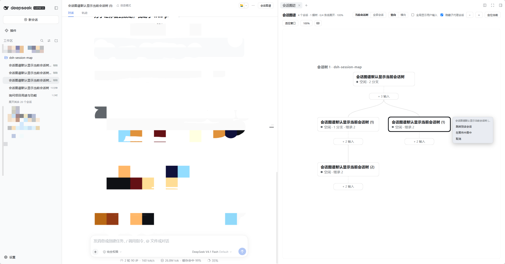
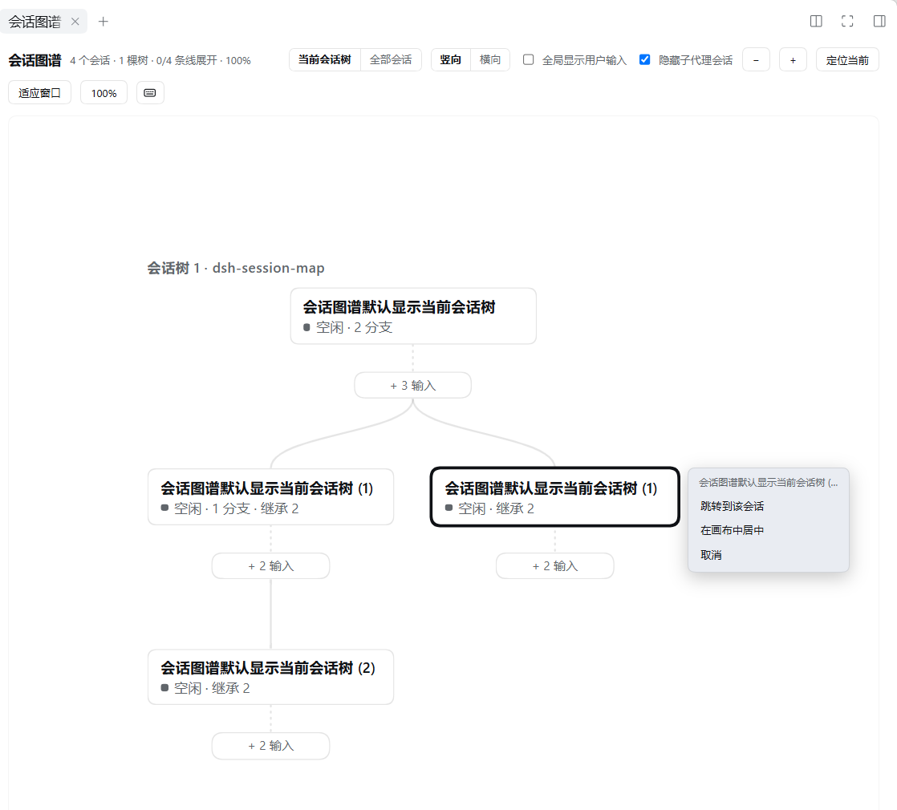

# dsh-session-map

> A fork-tree canvas over every DSH session — one conversation tab, one session-header toggle and two right-sidebar tabs. It opens on the current session's own tree, growing downward.

DSH 的会话会从某一轮 **fork** 出去，可左侧栏只是一张平铺列表：谁从谁分叉、手上这个会话在整张图里的位置，都得自己回忆。这个插件把 fork 关系画成树——**节点是会话，卡片下面那串珠子是该会话的用户输入**——谁从哪一轮分叉出来，一眼可见。

默认只画**当前会话所在的那棵树**，且**自上而下**生长；工具栏上两组开关各自一键切回「全部会话」与「横向」。

[](LICENSE)
[](https://github.com/xiguazhiPrince/dsh-session-map/stargazers)



## 亮点

| | |
|---|---|
| **当前会话的树** | 打开即定位：只铺开当前会话所在的那棵树——父链、与它并列的兄弟分支、以及它们的后代；一键切回全图 |
| **竖向生长** | 默认自上而下：子会话在父会话下方，兄弟分支左右排开，一张卡片的用户输入串挂在它下面；一键切回横向 |
| **轮次可视化** | 每条会话线串起它自己的用户输入。点珠子弹出该轮操作，链首胶囊展开 / 收起整条线，fork 继承的前缀折成 `+N 继承` 胶囊 |
| **画布手感** | 滚轮平移、Shift + 滚轮横向平移、Ctrl / ⌘ + 滚轮缩放、拖空白平移（不会选中文字），外加适应窗口 / 定位当前 / 100% |
| **一屏概览** | 另有一个「会话概览」标签页：轮次、步骤、模型耗时、工具耗时、输出 token、运行状态 |
| **三个入口** | 对话标签页、会话头部开关、右侧栏常驻标签页——哪里顺手用哪里（对话标签页默认关闭，见[使用](#对话标签栏的两个标签页默认关闭)） |



## 安装

GitHub 直装：

```sh
# 装进 web profile —— 就是 `dsh web` 启动的那个
dsh plugin --profile web add github:xiguazhiPrince/dsh-session-map

# 换你自己的 profile 名即可，例如 tui
dsh plugin --profile <你的 profile> add github:xiguazhiPrince/dsh-session-map
```

profile 名要**已经存在**于 `$DSH_HOME/profiles` 下（`dsh --help` 里 `--profile` 那一段就是它）；想新建一个就先用模板派生：`dsh myweb --from-default-profile web` 会照 `web` 模板建出 `myweb` 并启动它。安装走的是 profile 自己的 pnpm，装完这个包会同时写进它的 `dependencies` 与 `dsh.profile.bundles`。

**预构建分发。** 仓库里直接提交了构建产物 `lib/`，并且没有 `prepare` 脚本，所以 pnpm 只下载 tarball 解压，**不执行任何安装期代码**——不需要 `allowBuilds` 放行，也没有构建等待。

代价是产物可能与源码不同步：**改了 `src/` 必须先 `pnpm build` 再提交**（见[本地开发](#本地开发)）。

另外建议**钉住 commit**。不钉的话，仓库之后任何一次 push 都会改变你安装的内容：

```sh
dsh plugin --profile web add github:xiguazhiPrince/dsh-session-map#<sha>
```

## 安装后验证

装完不会立刻生效：**profile 的 bundle 列表是启动时读的**，正在运行的实例不会加载新行。先确认补丁栈里有这一层——

```sh
dsh --profile web --dump-config    # profile 名换成你装的那个
```

```yaml
# == dsh-session-map
- id: session-map
  name: dsh-session-map
```

然后重启该 profile 的进程并刷新页面。四处应该出现：

| 位置 | 应该看到 |
|---|---|
| 会话标签栏 | 「概览」与「会话图谱」两个标签页 |
| 会话头部工具区 | 「会话图谱」开关；右侧栏正显示图谱时再点一次会关闭它 |
| 右侧栏标签 | `dsh-session-map.map`（标题「会话图谱」）和 `dsh-session-map.overview`（标题「会话概览」） |
| 图谱页本身 | fork 树画布；默认只画当前会话的那棵树、且自上而下，工具栏的「当前会话树 / 全部会话」与「竖向 / 横向」两组开关可切回全图与原方向，旁边显示会话数、树数与当前缩放百分比 |

两件容易被当成故障的事：

- **切换会话后图谱没了。** 视图选择和右侧栏布局都是**按会话各存一份**的状态，没打开过的会话回落到它自己的默认值。从画布「跳转到该会话」时右侧栏的图谱会跟随过去；对话标签栏的图谱不会——那个选择属于 `ui-conversation`，插件没有接口去改。
- **点右侧栏开关没反应。** 按钮旁边会出现红色错误文字——失败不再只写进 console。把内容贴出来即可。

## 使用

### 三个入口

| 座位 | 内容 |
|---|---|
| `conversation.view` | 「概览」标签页（order 20）、「会话图谱」标签页（order 30）—— **默认关闭**，见下 |
| `conversation.session.header.utilities` | 会话头部的「会话图谱」开关（order 40）；右侧栏已打开时再点一次关闭 |
| `sidebar.right.pane.tab` | 常驻标签页 `dsh-session-map.overview` 与 `dsh-session-map.map` |

### 工具栏

| 控件 | 作用 |
|---|---|
| 「当前会话树 / 全部会话」 | 画布范围：当前会话所在的那棵树，或者列表里的全部会话 |
| 「竖向 / 横向」 | 树的生长方向：自上而下，或者自左向右 |
| 「全局显示用户输入」 | 一次铺开所有会话的用户输入串；关闭后逐条线单独展开 |
| 「隐藏子代理会话」 | 过滤 `origin: subagent` 的会话（默认开） |
| − / + / 100% / 适应窗口 / 定位当前 | 缩放与取景 |
| 键盘图标 | 快捷键表 |

### 画布交互

- 滚轮上下平移，Shift + 滚轮左右平移，Ctrl / ⌘ + 滚轮缩放；
- 拖动空白平移（不会选中文字），点空白收起菜单；
- 点击会话节点弹出操作菜单：**跳转到该会话** / **在画布中居中**；
- 点击链首的胶囊展开或收起该线的用户输入；fork 继承的输入前缀折叠成 `+N 继承` 胶囊；
- 点击输入珠子弹出该轮的操作。

### 画布默认只画当前会话的会话树

图谱打开时只铺开**当前会话所在的那棵树**：从树根（`parentId` 链上仍被列表列出的最远祖先）到它的所有后代，含与当前会话并列的兄弟分支。同一棵树上「还有谁从同一个父节点分叉」正是读当前会话时的上下文，所以整棵树一起给。

工具栏上的「当前会话树 / 全部会话」两段开关切换这个范围。范围只改画什么，不动几何：同一棵树在两种范围下的坐标完全一致。列表里还没有当前会话（快照尚未落地那一行）时，画布不缩成空图，而是照旧铺开全部，并在工具栏说明原因。

默认值写在 `src/client/views.ts` 的 `DEFAULT_MAP_SCOPE`（`'current'`），由 `src/client/index.ts` 装进插件 run 的开关。和其它工具栏开关一样，它挂在插件 run 上，所以那是**每次页面加载**的默认值：刷新后回到「当前会话树」。

### 画布默认竖向生长

树自**上而下**长：子会话在父会话下方，兄弟分支左右排开，一张卡片的用户输入串挂在它下面、竖着排成一列；分支从父卡片的链尾拉一条曲线到子卡片的顶边。横向模式是自左向右，输入串往右排。

工具栏上的「竖向 / 横向」两段开关切换方向。两个方向共用同一套布局：深度轴与分栏轴互换，画什么、折叠与展开状态、以及同一个节点在两种方向下的相对关系都不变；横向模式与引入竖向之前逐字段一致（含坐标与边路径）。

默认值写在 `src/client/views.ts` 的 `DEFAULT_MAP_DIRECTION`（`'vertical'`），同样由 `src/client/index.ts` 装进插件 run，所以也是**每次页面加载**的默认值。

### 对话标签栏的两个标签页默认关闭

「概览」和「会话图谱」这两个 `conversation.view` 入口由**浏览器本地偏好**控制，默认不注册。头部开关和右侧栏的两个标签页不受影响，图谱仍然可以从右侧栏正常使用；上图里的图谱就是右侧栏那个标签页。

在页面控制台里改，**刷新后生效**（不需要重新构建或重启）：

```js
localStorage.setItem('dsh.session-map.conversationViews', 'true')   // 打开
localStorage.setItem('dsh.session-map.conversationViews', 'false')  // 显式关闭
localStorage.removeItem('dsh.session-map.conversationViews')        // 回到出厂默认
```

出厂默认写在 `src/client/index.ts` 的 `DEFAULT_CONVERSATION_VIEWS`。

**为什么不用 profile 里的 `config`**：浏览器半由 web boot 用**裸 `{ name }`** 创建（`packages/client/web/src/boot-client.ts:50`），而 boot manifest 的插件行只带 `id` / `inject` / `immediately`——宿主行的 `config` 到不了客户端插件。给这个包写 `config` 不会有任何效果。

## 本地开发

```sh
pnpm install
pnpm build        # 产出 lib/index.js 与 lib/client.js
pnpm typecheck    # tsc --noEmit
```

`tsdown.config.ts` 不做类型检查、也不用 project references，所以构建是自包含的，类型检查是独立的一步。

**提交前务必 `pnpm build`**：`lib/` 是仓库内容的一部分，安装方不会替你构建。

## 两个产物

| 产物 | 形态 | 谁用 |
|---|---|---|
| `lib/index.js` | ESM | 宿主 Loader 按包名 import |
| `lib/client.js` | CJS closure factory | 浏览器内核通过 module table 取用 |

浏览器半外面包了一层交接，由本仓库的 `tsdown.config.ts` 自己声明：

```js
window.__ModuleLoader__.load({ id: 'dsh-session-map', factory: (require) => { … } });
```

产品自带的 `packages/client/tsdown.client.ts` 预设是**仓库内部**的（它会去读 `packages/<group>/<pkg>/package.json` 并 import 同仓的构建模块），独立仓库导不进来，所以这里自己写。React 与 `@deepseek-ai/cordis` 保持 `require` 外部化，由内核的 `require` 提供；本插件不 import 其它产品包，所以产物里只有自己的代码。

## 状态

**已在本机验证**：

- GitHub 直装全流程——下载 tarball → 解压 → 写进 profile 的 `dependencies` → 回写 `dsh.profile.bundles`；**4.6 秒，零安装期脚本**；
- `--dump-config` 里出现 `# == dsh-session-map` 层；
- 首页 HTML 的 boot manifest 列出了 `dsh-session-map/client.js`，合并后的插件包请求返回 200 且含 `__ModuleLoader__` 工厂交接；
- 两个产物的文件名与 React 外部化（`lib/client.js` 里是 `require("react")`，没有内联）。

**一个包同时是 bundle 和 client 插件是可行的**：产品随附的布局把两者拆成不同的包（bundle 的 patch 行去引用 `packages/client/*` 里的插件包），但自引用同样能被浏览器 roster 收下。

**已完成**：仓库结构、`dsh.bundle` 层、`dsh.client` 声明、宿主半、构建契约，以及全部画布与交互。

## 宿主契约（升版必读）

浏览器半读的是**运行时快照**，产品不承诺它们稳定。已经踩到过两次，都表现为「样式坏了」但其实是契约漂移：

| 读的东西 | 现在怎么读 | 漂移前 |
|---|---|---|
| 当前会话 | Session 列表快照里 `retainedBy.mainView > 0` 的那一行（`mainSessionId`），退而用座位上自己的 `sessionId` | 快照曾直接给 `current` |
| 排队条数 | `pendingSubmissions`（0.1.7 的名字） | 曾叫 `queue` |

判断「当前会话」时不要发明新口径：产品自己的每个包都按 `retainedBy.mainView` 推导（标题栏、open-in-app、agent-preset 皆然）。快照里还没有 `current` 时，旧写法只会拿到 `undefined`，而 `undefined` 不会报错——画布只是安静地退回「整张全局图」，也没有任何卡片亮起当前会话的描边。

同一次审计过了其余接口：`useSessions` 的 `ids` / `byId` / `phase`、`useWorkspaces` 的 `items`、投影键 `title` / `sessionStats` / `turnOutline`、以及会话快照的 `running` / `hasMore` 都还在。

## 源码结构

```
src/index.ts            宿主半（空实现，只为占据 bundle 行）
src/client/index.ts     apply：样式表、插件级开关、座位与标签页注册
src/client/views.ts     概览页、头部按钮、画布视图工厂
src/client/graph.ts     布局：范围过滤、生长方向、fork 树、珠子、折叠标记、连边
src/client/css.ts       样式表字符串
src/client/constants.ts 几何常量与 tab type id
src/client/flags.ts     跨挂载存活的插件级开关
src/client/format.ts    数字与耗时格式化
docs/example.png        界面截图（README 用）
docs/example-map.png    图谱细节截图（README 用）
```

样式表以字符串形式随包分发，由 `apply` 里的一个 effect 建 `<style>` 元素并负责移除。产品的 `styles` 服务只存在于动态运行时，正式插件没有它。

**改完源码务必 `pnpm build` 再提交**——`lib/` 是仓库内容的一部分，安装方不会替你构建。
